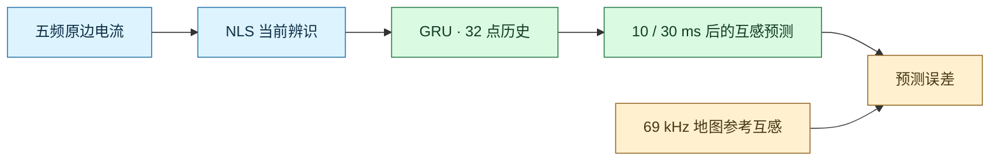

<h1 align="center">LCC-S 无线传能系统动态互感的短时预测</h1>

线圈运动时，能否仅凭已经采到的原边电流，预测 10 ms 和 30 ms 后的互感？

<a href="#主要结果">主要结果</a> · <a href="#预测方法">预测方法</a> · <a href="#论文图表">论文图表</a> · <a href="#实验口径">实验口径</a>

## 主要结果

> [!IMPORTANT]
> **提前 30 ms，GRU 将互感预测的平均绝对百分比误差相对降低了 18.82%。** 对照方法将当前的 NLS 互感估计直接保持到目标时刻。比较覆盖 60 条运动分布外测试轨迹，电流相量噪声为 1%。

| 预测方法 | 平均绝对百分比误差（MAPE）↓ | 平均绝对误差（MAE）↓ |
| :--- | ---: | ---: |
| 保持当前互感估计 | 1.9288% | 0.368 μH |
| **GRU** | **1.5659%** | **0.298 μH** |

## 预测方法

每 5 ms 采集一包五频原边电流，用非线性最小二乘（NLS）辨识当前参数。门控循环网络（GRU）读取最近 32 个采样点的辨识历史，给出未来互感。到达目标时刻后，再用该时刻的线圈位置从 69 kHz 电磁地图取出参考互感，计算预测误差。

## 论文图表

正文图 6 和图 7 分别展示当前互感辨识与未来互感跟踪。表 3 和表 4 给出六种方法的误差及逐轨迹配对比较。

<strong>图 1–8</strong>　从 LCC-S 电路到 GRU 预测跟踪

| 论文图号 | 图回答的问题 | 对应的归档材料 |
|---|---|---|
| 图 1　LCC-S 电路 | 从电路的哪一侧采集电流？互感位于哪个环节？ | 标称电路参数 |
| 图 2　线圈几何与网格 | 位置到复阻抗的电磁地图源自什么线圈模型？ | 论文所用 COMSOL 几何与网格截图，原生模型在六类归档中的第 01 类 |
| 图 3　动态观测与评分参考 | 怎样由同一条运动轨迹生成原边观测，并在目标时刻取参考互感？ | 流程示意图，运动参数和动态观测分别在第 02、03 类 |
| 图 4　原边电流 | 代表性运动中的电流包络和末段 100 μs 载波是什么形态？ | ID 包络 / 载波，OOD 包络 / 载波 |
| 图 5　GRU 结构 | 模型如何从一段辨识历史直接给出多个未来时刻的预测？ | 输入、门控循环层与输出的结构示意图，训练记录与权重在第 04 类 |
| 图 6　当前互感辨识 | 预测开始前，NLS 对当前互感的辨识效果如何？ | 当前估计与参考曲线 · 单个五频观测包 |
| 图 7　GRU 预测跟踪 | 在同一条运动轨迹上，10 ms 和 30 ms 预测各自如何跟踪目标互感？ | 两条轨迹、两种时域的 1,460 行对齐数据，`origin_s` 为用于本次预测的末次观测时刻，`target_s` 为评分时刻 |
| 图 8　时域与噪声 | 延长预测时域或改变电流观测噪声后，误差怎样变化？ | 分预测时域 · 10 ms 分噪声水平 |

<strong>表 1–5</strong>　数据划分、预测误差、配对收益与桌面耗时

| 论文表格 | 对应的归档材料与统计口径 |
|---|---|
| 表 1　数据划分与仿真核对 | 轨迹分组、种子及复用关系 · 载波电路核对。48 条训练和 12 条验证轨迹采用准静态观测。主测试的 120 条动态轨迹单独计数，24 条桥接比较与 2 条复用验证轨迹保留配对标记。 |
| 表 2　五频 NLS 同刻辨识 | 分组汇总 · 逐轨迹辨识误差。`common_current` 对应共同预测起点，`all_current` 对应每条轨迹的全部 401 个观测包。 |
| 表 3　六种方法的 10 ms 与 30 ms 预测 | 按时域和方法汇总 · 1,440 条逐轨迹 MAPE。正文采用 10 ms 和 30 ms 的结果。 |
| 表 4　GRU 相对各基线的收益 | 配对差值、置信区间和胜出轨迹数 · 分运动族汇总。相对降幅为 `100 × (基线 MAPE − GRU MAPE) / 基线 MAPE`。区间沿用实验归档的分层轨迹重采样结果。 |
| 表 5　桌面原型耗时 | 四步 GRU 分项计时 · 750 次调用记录。四步模型提供 10 ms 输出。该表的计时对象仅为四步实现。 |

## 实验口径

| 数据与比较 | 设置 |
| :--- | :--- |
| 训练与验证 | 48 条训练轨迹、12 条验证轨迹，均采用准静态观测。 |
| 主测试 | 120 条 Simulink 动态观测轨迹。分布内（ID）和运动分布外（OOD）各 60 条，每组 6 个运动族、每族 10 条。 |
| 10 ms 预测 | 四步模型，每条轨迹 366 个共同预测起点。 |
| 30 ms 预测 | 六步模型，每条轨迹 364 个共同预测起点。 |
| 方法对照 | `CurrentHold` 保持当前 NLS 估计，`DenoisedHold` 保持去噪估计。未来预测比较 `Linear`、`Ridge_Residual`、`TCN_Residual` 和 `GRU`。 |

六种方法在相同测试域和预测时域内按轨迹配对。论文评价仿真观测下的离线预测精度，表 5 单独报告四步模型的桌面耗时。

---

**V19 公开材料**　本页提供研究摘要与图表索引。源代码、图表文件、附件 S1 和逐轨迹数据由作者私下保存。
